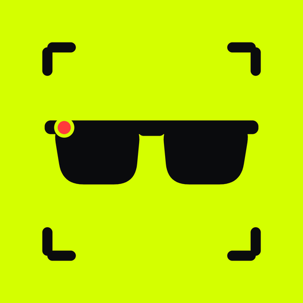
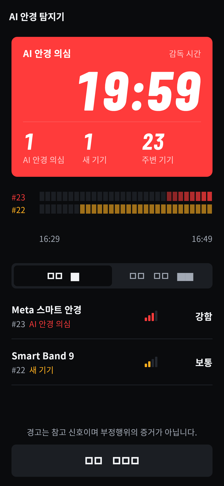
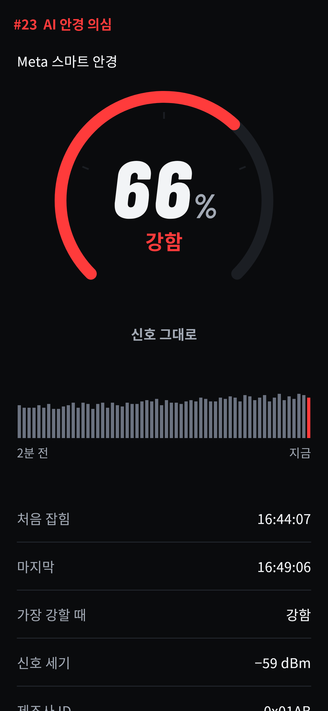
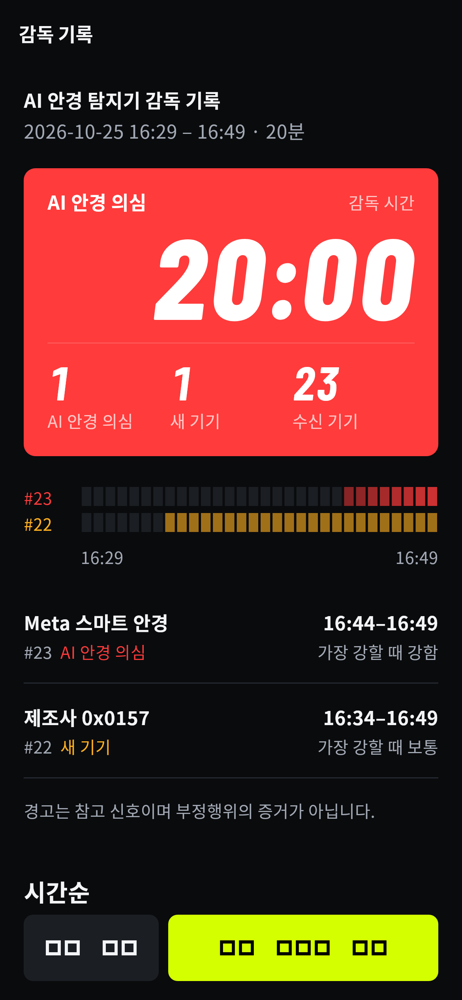

<p align="center"></p>

# AI 안경 탐지기

시험 감독관이 자기 휴대폰으로 시험장 안의 AI 스마트 안경을 찾는 무료 오픈소스 앱입니다.
레이밴 메타 같은 AI 안경이 내보내는 블루투스 신호를 잡아서 감독관에게 알려 줍니다.
학교 시험, 대학 논술, 자격증 시험, 학원 모의고사에서 쓰도록 만들었습니다.

이 앱은 Yves Jeanrenaud가 만든 [Nearby Glasses](https://github.com/yjeanrenaud/yj_nearbyglasses)의 포크입니다.
탐지 방법과 탐지 시그니처는 원작 프로젝트의 연구를 따랐고, 앱은 한국 시험 감독에 맞게 Flutter로 새로 만들었습니다.
원작과 별개의 앱이며 원작자가 이 앱을 보증하지 않습니다. 공공장소에서 쓸 탐지기가 필요하다면 원작 앱을 쓰십시오.

<p align="center">
  
  
  
  
</p>

## 하는 일

AI 안경은 휴대폰과 연결하려고 블루투스 저전력(BLE) 광고 신호를 계속 내보냅니다.
앱은 이 신호를 받기만 합니다. 기기에 연결하지 않고 신호에 담긴 데이터도 풀어 보지 않습니다.

- AI 안경 의심(빨강): 신호의 제조사 ID, 서비스 UUID, 기기 이름이 알려진 AI 안경과 같을 때 알립니다. 지금 찾는 제조사 ID는 Meta 0x01AB와 0x058E, EssilorLuxottica 0x0D53, Snap 0x03C2, Jieli 0x05D6입니다. HeyCyan 계열 안경은 서비스 UUID와 기기 이름으로 찾습니다.
- 새 기기(노랑): 감독을 시작할 때 교실에 있던 기기를 기억해 둡니다. 그 뒤에 새로 나타난 기기가 있으면 알립니다. 검사를 마친 뒤 안경을 바꿔 끼는 경우를 잡으려고 넣은 기능입니다.
- 신호 세기: 경고가 난 기기의 신호가 감독관 휴대폰에 얼마나 세게 들어오는지 보여 줍니다.
- 감독 기록: 감독이 끝나면 기록을 이미지로 공유하거나 세부 로그를 텍스트 파일로 내보낼 수 있습니다.

## 원작과 다른 점

| | Nearby Glasses | AI 안경 탐지기 |
|---|---|---|
| 쓰는 곳 | 공공장소 | 시험장 |
| 새 기기 감지 | 없음 | 감독 시작 때 교실 기기를 기억하고, 그 뒤에 나타난 기기를 알림 |
| 신호 세기 | 알림 | 기기별 신호 세기 게이지와 최근 2분 기록 |
| 기록 | 디버그 로그 | 감독 기록 이미지와 세부 로그. 블루투스 주소와 기기 이름은 넣지 않음 |
| 시그니처 | 코드 안에 있음 | 데이터 파일(app/assets/signatures.json)로 분리 |
| 언어 | 여러 언어 | 한국어 |
| 구현 | Kotlin, Swift | Flutter |

## 알아 두어야 할 한계

- 경고는 참고 신호이며 부정행위의 증거가 아닙니다. 메타 퀘스트 같은 VR 기기나 같은 칩을 쓰는 이어폰도 같은 신호를 낼 수 있습니다. 확인은 감독관이 직접 해야 합니다.
- 신호 세기는 사람 몸과 책상에 가려 크게 흔들립니다. 교실 안에 있는지는 짐작할 수 있지만, 어느 좌석인지는 알 수 없습니다.
- 블루투스를 끄고 녹화만 하는 기기는 찾을 수 없습니다. 실시간으로 답을 받으려면 블루투스 연결이 필요하므로, 그런 방식의 부정행위는 막을 수 있습니다.
- Android는 화면이 꺼지면 이 앱이 쓰는 방식의 블루투스 스캔을 멈춥니다. 그래서 감독 중에는 앱이 화면을 켜 둡니다.
- 이븐리얼리티스 G1과 G2, 로키드, 샤오미, 알리바바 Quark, 삼성 갤럭시 글래스는 아직 신호 자료가 없습니다. 이 제품들은 새 기기 감지로만 잡힐 수 있습니다. 실물 신호 자료를 보내 주시면 반영하겠습니다.

## 개인정보

앱에는 인터넷 권한이 없습니다. 서버, 광고, 분석 도구도 없습니다.
감독 데이터는 휴대폰 메모리에만 있고 감독 기록 화면을 나가면 지워집니다.
내보내는 기록에는 블루투스 주소와 광고된 기기 이름이 들어가지 않습니다.

## 문서

앱 안의 앱 정보 화면에서도 같은 문서를 볼 수 있습니다.

- [이용약관](app/assets/docs/terms.md)
- [개인정보처리방침](app/assets/docs/privacy.md)
- [감독관과 시험 주최 측을 위한 사용 지침](app/assets/docs/guide.md)
- [업데이트 기록](app/assets/docs/changelog.md)
- [설계와 검증 기록](docs/design-record.md)

## 직접 빌드하기

- 필요한 것: Flutter 3.47 이상, JDK 17, Android SDK(compileSdk 37)
- 테스트와 빌드: `cd app`, `flutter test`, `flutter build appbundle --release`
- 실물 안경 없이 시험해 보는 방법은 [docs/testing.md](docs/testing.md)에 있습니다. `--dart-define=SIMULATE=true`로 빌드하면 가짜 신호로 움직이는 개발용 모의 모드가 켜집니다.
- 서명과 스토어 출시 절차는 [docs/release.md](docs/release.md)에 있습니다.

## 시그니처 추가하기

새 AI 안경의 신호를 찾았다면 app/assets/signatures.json에 항목을 하나 추가하면 됩니다. 코드는 고치지 않아도 됩니다.

```json
{ "id": "vendor-xxxx", "label": "표시 이름", "match": { "companyIds": ["0x1234"] }, "note": "오탐 가능성 등" }
```

`match`에는 `companyIds`, `serviceUuids`, `nameContains`를 쓸 수 있습니다.
새로 찾은 시그니처는 원작 저장소의 [식별자 수집 이슈](https://github.com/yjeanrenaud/yj_nearbyglasses/issues/56)에도 알려 주십시오.

## 라이선스

[GNU AGPL-3.0](LICENSE)으로 배포합니다. 원작 Nearby Glasses의 저작권은 Yves Jeanrenaud에게 있습니다.
이 앱을 고쳐서 배포하거나 서비스로 제공한다면 전체 소스 코드를 같은 라이선스로 공개해야 합니다.
원작, 함께 쓰는 라이브러리, 글꼴, 상표에 관한 내용은 [NOTICE](NOTICE)에 있습니다.

## 만든 곳

걸다 주식회사 (GEOLDA Co., Ltd.)
문의: contact@sinogram.co.kr
버그와 제안은 [이슈](https://github.com/Official-Belta/ai-glasses-detector/issues)에 남겨 주십시오.
